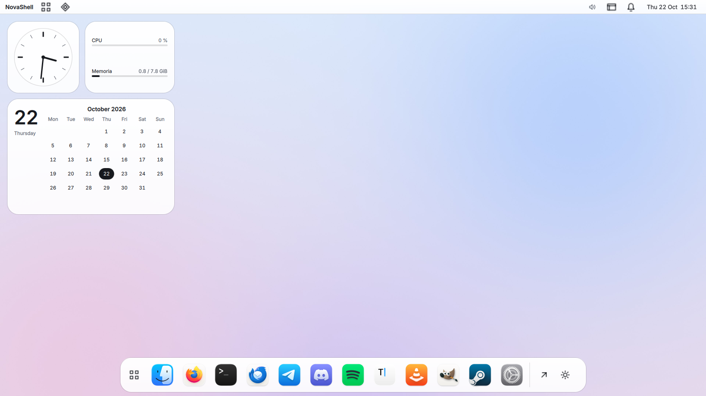
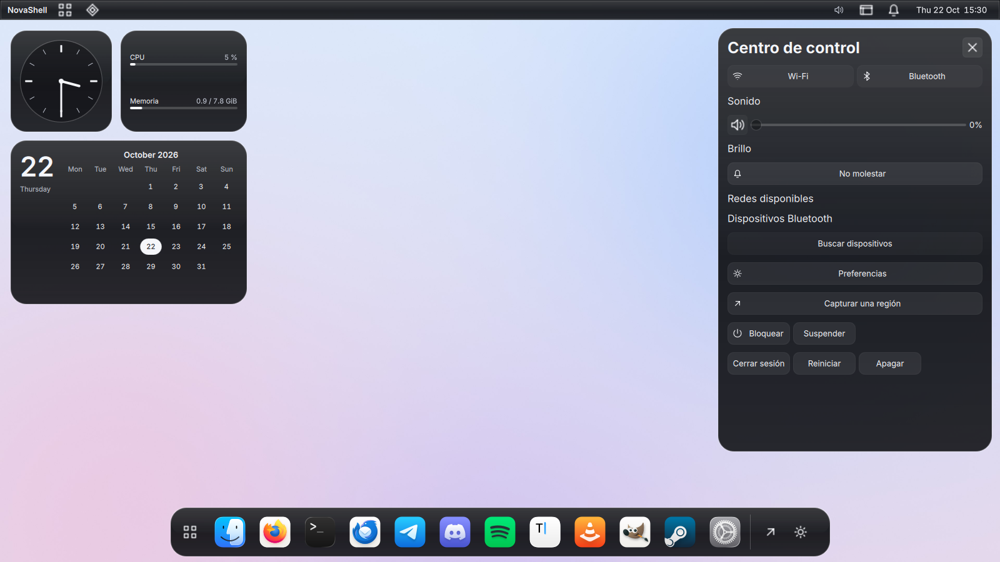
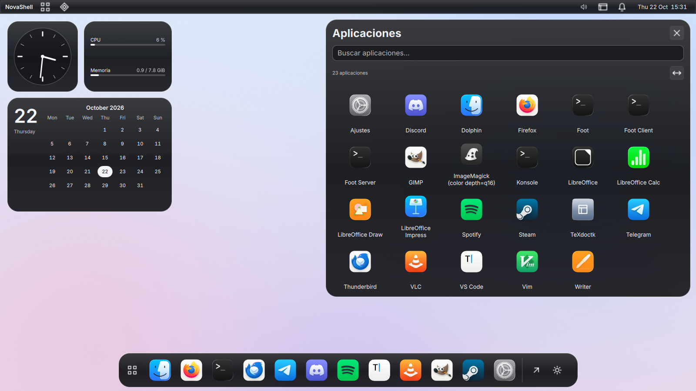
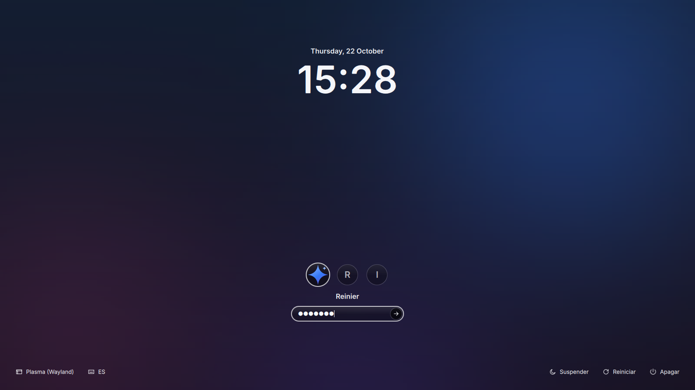

<h1 align="center">K-Nova · NovaShell</h1>

<p align="center"><strong>Un escritorio Quickshell para KDE Plasma 6, con identidad propia y sin root.</strong></p>

<p align="center"><code>Plasma 6.8+ / Wayland</code> · <code>Quickshell 0.3.2+</code> · <code>Qt 6.12+</code> · <code>GPL-3.0-or-later</code></p>

<p align="center"></p>

> **Versión 0.2.0 (pre-release).** Todo lo descrito funciona con Quickshell
> 0.3.2 y Qt 6.12 reales y pasa el CI (incluida una instalación completa en
> un usuario vacío), pero aún no se ha validado en una sesión Plasma 6.8 ni con
> SDDM reales (blur de KWin, GPU, consumo en reposo y servicios del sistema). Ver [cambios](CHANGELOG.md) y [hoja de ruta](docs/HOJA-DE-RUTA.md).

## Qué incluye

| | |
| :--- | :--- |
| **Barra superior** | Lanzador, apariencia, bandeja del sistema, indicadores de red, Bluetooth, volumen y batería; el reloj abre «Hoy». |
| **Dock** | Apps fijadas con iconos del sistema, menú contextual, autoocultación y ampliación opcional. |
| **Lanzador** | Búsqueda sin acentos, teclado completo y progreso real del catálogo. |
| **Centro de control** | Wi-Fi, Bluetooth, sonido, brillo, No molestar, capturas y acciones de sesión. |
| **Ajustes** | Barra lateral: apariencia, escritorio, dock, barra, notificaciones, accesibilidad, privacidad e integración. |
| **Widgets** | Reloj analógico, uso de CPU/memoria y calendario sobre el fondo. |
| **Apariencia** | Liquid Glass sin acento de color: vidrio claro en claro y negro translúcido en oscuro. Cristal, Esmerilado y Sólido; alto contraste, menos transparencia y menos movimiento. |
| **Sesión** | Tema SDDM, splash, fondo claro/oscuro, fondo de bloqueo y bienvenida de primer uso. |
| **Iconos** | Biblioteca MacTahoe (GPL-3.0, 16 602 nombres) y carpetas propias, sin red. |

<p align="center">
  
  
</p>
<p align="center"></p>

El diseño sigue las pautas de Apple para Liquid Glass, movimiento y progreso:
vidrio solo en la capa de navegación, nada de vidrio sobre vidrio, movimiento
breve y opcional, y progreso honesto. El blur de fondo se activa solo si el
compositor anuncia `ext-background-effect-v1`; sin él la superficie mantiene
una opacidad legible. No hay plugins nativos de KWin.
[Contrato visual](docs/APARIENCIA.md).

## Instalar

Requisitos: KDE Plasma 6.8+ en Wayland, Qt 6.12+ y
[Quickshell](https://quickshell.org/docs/v0.3.0/guide/install-setup) 0.3.2+
compilado para tu misma versión de Qt. La **[guía de instalación](docs/INSTALACION.md)**
tiene los paquetes por distribución, cada paso explicado y solución de problemas.

```sh
git clone --branch v0.2.0 https://github.com/ReinierTutoriales/K-Nova-NovaShell.git
cd K-Nova-NovaShell
./tools/novactl doctor                    # comprueba sesión, Plasma, Quickshell y Qt
./tools/novactl install                   # compila e instala en tu usuario, sin root
./tools/novactl start && ./tools/novactl enable
./tools/novactl desktop-profile apply     # opcional: splash, fondo de bloqueo, Dolphin y KWin
./tools/novactl login-theme install       # opcional: tema SDDM (imprime la orden con sudo)
```

NovaShell convive con el panel de Plasma; no sustituye `plasmashell` ni cambia
el tema global. Para desinstalar: `./tools/novactl uninstall` (`--purge`
borra también tus ajustes). Actualizar y desinstalar paso a paso:
[guía](docs/INSTALACION.md#9-actualizar).

## Uso

| Orden | Qué hace |
| :--- | :--- |
| `novactl start \| stop \| restart \| status \| logs` | Gestiona los servicios de usuario. |
| `novactl version` | Versión de las fuentes y la instalada. |
| `novactl desktop-profile preview\|apply\|restore\|status [balanced\|glass\|reduced]` | Perfil reversible: Dolphin, efectos de KWin, splash y fondo de bloqueo ([detalles](docs/ESCRITORIO-NATIVO.md)). |
| `novactl login-theme preview\|install\|uninstall\|status` | Tema SDDM: vista previa sin root; instalarlo en el sistema imprime la orden con `sudo` ([detalles](docs/SESION.md)). |
| `qs ipc call novashell toggle <launcher\|controls\|notifications\|settings\|overview\|clipboard\|widgets\|welcome>` | Abre o cierra un panel; asígnalo a un atajo en Ajustes de KDE → Atajos. |

## Documentación

| Documento | Contenido |
| :--- | :--- |
| [Instalación](docs/INSTALACION.md) | Paso a paso, actualización, desinstalación y problemas. |
| [Arquitectura](docs/ARQUITECTURA.md) | Piezas, reglas, seguridad del IPC y consumo en reposo. |
| [Contrato IPC v1](docs/CONTRATO-IPC-v1.md) | Todas las operaciones del daemon. |
| [Apariencia](docs/APARIENCIA.md) | Materiales, blur, iconos y pautas de Apple aplicadas. |
| [Escritorio nativo](docs/ESCRITORIO-NATIVO.md) | Perfiles de Dolphin y KWin. |
| [Sesión](docs/SESION.md) | Inicio de sesión (SDDM), splash, fondo, bloqueo y bienvenida. |
| [Optimización](docs/OPTIMIZACION.md) | Criterios de rendimiento y su comprobación. |
| [Desarrollo](docs/DESARROLLO.md) | Compilar, probar y contribuir. |
| [Lanzamientos](docs/LANZAMIENTO.md) | Cómo se publica una versión. |
| [Hoja de ruta](docs/HOJA-DE-RUTA.md) | Estado comprobado y pendientes. |

## Desarrollo

```sh
cmake -S . -B build -G Ninja -DNOVA_WERROR=ON && cmake --build build
ctest --test-dir build --output-on-failure
python3 tools/check-sources.py
shellcheck -x tools/novactl
./tools/novactl dev        # shell desde las fuentes, con recarga en caliente
```

El CI compila con la última Qt estable, ejecuta el daemon con ASan/UBSan,
arranca el shell con Quickshell real y renderiza la interfaz con Qt. Detalles
en la [guía de desarrollo](docs/DESARROLLO.md).

## Licencias

[GPL-3.0-or-later](LICENSE) y [avisos de terceros](THIRD_PARTY_NOTICES.md).
Las partes adaptadas están identificadas por archivo y la distribución combinada
cumple GPLv3. Los iconos de terceros son arte comunitario; no son recursos
oficiales de Apple. Las marcas de las aplicaciones pertenecen a sus dueños.
